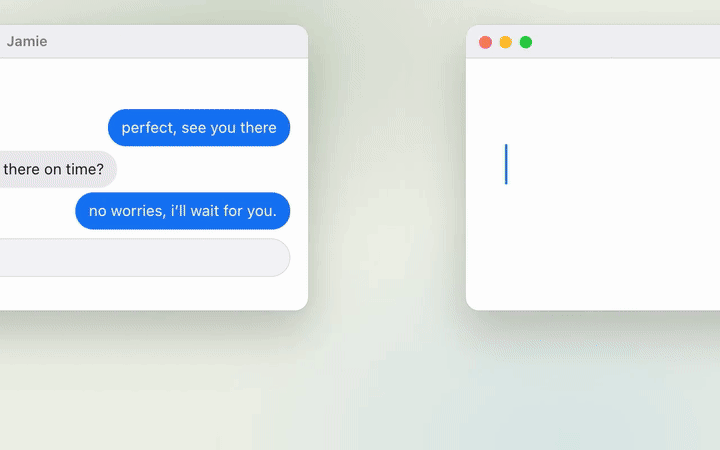

<p align="center">
  <picture>
    <source media="(prefers-color-scheme: dark)" srcset=".github/readme/hero-dark.png">
    
  </picture>
</p>

Hunch is a writing companion for your Mac. Start typing in any app, Messages, Mail, Slack, your browser,
a terminal, and Hunch finishes the thought in grey right at your cursor. Press Tab to take a word. Keep
typing to ignore it. Everything runs on a language model on your own Mac: no account, no cloud, no
keystrokes sent anywhere.

## Has a hunch about what you'll say next.

<picture>
  <source media="(prefers-color-scheme: dark)" srcset=".github/readme/suggestions-dark.gif">
  
</picture>

Suggestions follow what's on screen: the message you're answering, the email thread, the page you're on.
Hunch learns your words and the way you write, and keeps a separate voice for each place: casual in
chats, polished at work, precise in AI prompts.

## Choose your mood.

<picture>
  <source media="(prefers-color-scheme: dark)" srcset=".github/readme/effects-dark.gif">
  
</picture>

Suggestions can arrive with an effect: paw prints, a decoder scramble, falling leaves and more, each
one tunable, and a different one per app if you like.

## Autocorrect that reads the room.

<picture>
  <source media="(prefers-color-scheme: dark)" srcset=".github/readme/autocorrect-dark.gif">
  
</picture>

Type fast and sloppy. Hunch fixes the slips as you go, and settles the ones only the whole sentence can
decide (weather or whether?). In chats it leaves your lowercase and "idk" alone.

## Rough in. Polished out.

<picture>
  <source media="(prefers-color-scheme: dark)" srcset=".github/readme/write-for-me-dark.gif">
  
</picture>

Jot down the gist and press ⇧Tab. **Write for me** turns it into a reply that fits the conversation,
shaped as an email, a text or an AI prompt depending on where you are.

## Stumble, pause, change your mind. Hunch types what you meant.

<picture>
  <source media="(prefers-color-scheme: dark)" srcset=".github/readme/dictation-dark.gif">
  
</picture>

Dictate into any field. Hunch transcribes on your Mac, drops the ums and false starts, follows "no wait,
make that…", and writes it in the style of the app you're in.

## Nothing leaves your Mac.

Hunch runs open models locally through [llama.cpp](https://github.com/ggml-org/llama.cpp) and
[whisper.cpp](https://github.com/ggml-org/whisper.cpp). The welcome tour recommends a model for your Mac's
memory and downloads it for you. What Hunch learns stays in a file on your Mac, and you can turn off
learning, screen context or everything at once for any app or site. Password fields are never read.

## Get started

**Requirements:** an Apple Silicon Mac on macOS 26 or later, and a few GB of free disk space for the
model.

### Download

1. Download the latest `Hunch-….dmg` from [Releases](../../releases/latest), open it, and drag
   **Hunch** onto **Applications**.
2. Open Hunch from your Applications folder. Hunch isn't signed with an Apple Developer ID or
   notarized, so macOS stops it the first time with *"Hunch" Not Opened*. Click **Done** (not Move
   to Trash).
3. Open **System Settings → Privacy & Security** and scroll down to **Security**. Next to *"Hunch"
   was blocked to protect your Mac*, click **Open Anyway**. The button only shows for about an hour
   after you tried to open the app, so if it isn't there, open Hunch again first.
4. Click **Open Anyway** in the dialog and confirm with your password or Touch ID. You only do this
   once. Updates that you drag over the old copy open normally and keep their permissions.
5. Follow the welcome tour. Hunch asks for **Accessibility** and **Input Monitoring**. It asks for
   **Screen Recording** only if you want screen context, and for the **Microphone** only for
   dictation. Hunch then downloads a model that fits your Mac.

Prefer Terminal? Run this after step 1 instead of steps 2–4:

```bash
xattr -dr com.apple.quarantine /Applications/Hunch.app
```

### Build from source

1. Install the Xcode version that ships the Swift 6.2 toolchain (`scripts/build-app.sh` points at it;
   set `DEVELOPER_DIR` to use another).
2. Create a signing certificate once, so macOS keeps Hunch's permissions across updates: in Keychain
   Access, Certificate Assistant → Create a Certificate…, name it `Hunch Local Signing`, type *Code
   Signing*.
3. Build, install and launch:

   ```bash
   scripts/build-app.sh
   ```

   ```bash
   scripts/install-app.sh --open
   ```

4. Follow the welcome tour, as in step 5 above.

Run the tests with `swift test`. `scripts/make-dmg.sh` packages the built app as a disk image.

## Updates

What's new in **1.0.1** ([download](../../releases/latest)):

- Suggestions stop at the text field's right edge on a whole word; the rest shows once your typing wraps to the next line.
- Autocorrect: undo an automatic fix with a quick double (or triple) Backspace.
- Write for me: no made-up reference material when there's little or nothing on screen; the draft's effect plays one whole line at a time.
- Quick replies follow the message box when it moves after the chips show.
- Shortcut recorder: real F-key names, refuses keys that type text without a modifier, and warns when two shortcuts share keys.
- Learned words can start after Chinese text, curly quotes or dashes.
- Settings: explanations behind the ⓘ icons, tips in section footers, and links between panes.
- Hunch's data files can only be read by your user account.
- Smaller fixes in Settings and Quick replies.

Earlier versions are on the wiki's [Updates](../../wiki/Updates) page.

## Learn more

The [wiki](../../wiki) is the full manual: every setting, the keyboard shortcuts, what Hunch keeps on
your Mac and how to delete it, troubleshooting, and how it all works inside, from reading text fields
to the language model engine.

## License

[MIT](LICENSE). Word-list credits are in [THIRD-PARTY-NOTICES.md](THIRD-PARTY-NOTICES.md).
