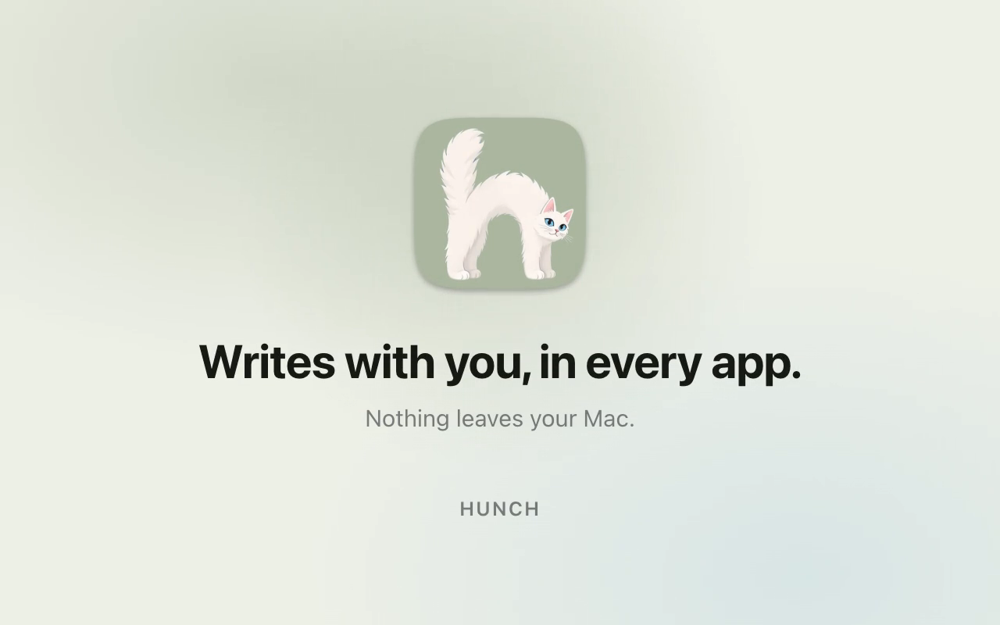
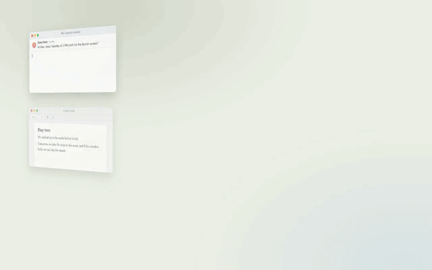

<p align="center">
  <picture>
    <source media="(prefers-color-scheme: dark)" srcset=".github/readme/hero-dark.png">
    
  </picture>
</p>

Hunch is a writing companion for your Mac. Start typing in any app, Messages, Mail, Slack, your browser,
a terminal, and Hunch finishes the thought in grey right at your cursor. Press Tab to take a word. Keep
typing to ignore it. Everything runs on a language model on your own Mac: no account, no cloud, no
keystrokes sent anywhere.

## Has a hunch about what you'll say next.

<picture>
  <source media="(prefers-color-scheme: dark)" srcset=".github/readme/suggestions-dark.gif">
  
</picture>

Suggestions follow what's on screen: the message you're answering, the email thread, the page you're on.
Hunch learns your words and the way you write, and keeps a separate voice for each place: casual in
chats, polished at work, precise in AI prompts.

## Choose your mood.

<picture>
  <source media="(prefers-color-scheme: dark)" srcset=".github/readme/effects-dark.gif">
  
</picture>

Suggestions can arrive with an effect: paw prints, a decoder scramble, falling leaves and more, each
one tunable, and a different one per app if you like.

## Autocorrect that reads the room.

<picture>
  <source media="(prefers-color-scheme: dark)" srcset=".github/readme/autocorrect-dark.gif">
  
</picture>

Type fast and sloppy. Hunch fixes the slips as you go, and settles the ones only the whole sentence can
decide (weather or whether?). In chats it leaves your lowercase and "idk" alone.

## Rough in. Polished out.

<picture>
  <source media="(prefers-color-scheme: dark)" srcset=".github/readme/write-for-me-dark.gif">
  
</picture>

Jot down the gist and press ⇧Tab. **Write for me** turns it into a reply that fits the conversation,
shaped as an email, a text or an AI prompt depending on where you are.

## Stumble, pause, change your mind. Hunch types what you meant.

<picture>
  <source media="(prefers-color-scheme: dark)" srcset=".github/readme/dictation-dark.gif">
  
</picture>

Dictate into any field. Hunch transcribes on your Mac, drops the ums and false starts, follows "no wait,
make that…", and writes it in the style of the app you're in.

## Nothing leaves your Mac.

Hunch runs open models locally through [llama.cpp](https://github.com/ggml-org/llama.cpp) and
[whisper.cpp](https://github.com/ggml-org/whisper.cpp). The welcome tour recommends a model for your Mac's
memory and downloads it for you. What Hunch learns stays in a file on your Mac, and you can turn off
learning, screen context or everything at once for any app or site. Password fields are never read.

## Get started

**Requirements:** macOS 26 on Apple Silicon, and a few GB of free disk space for the model.

Build it from source:

1. Install the Xcode version that ships the Swift 6.2 toolchain (`scripts/build-app.sh` points at it;
   set `DEVELOPER_DIR` to use another).
2. Create a signing certificate once, so macOS keeps Hunch's permissions across updates: in Keychain
   Access, Certificate Assistant → Create a Certificate…, name it `Hunch Local Signing`, type *Code
   Signing*.
3. Build, install and launch:

   ```bash
   scripts/build-app.sh
   ```

   ```bash
   scripts/install-app.sh --open
   ```

4. Follow the welcome tour. Hunch asks for **Accessibility** and **Input Monitoring**; **Screen
   Recording** only if you want screen context, and the **Microphone** only for dictation.

Run the tests with `swift test`.

## License

[MIT](LICENSE). Word-list credits are in [THIRD-PARTY-NOTICES.md](THIRD-PARTY-NOTICES.md).
